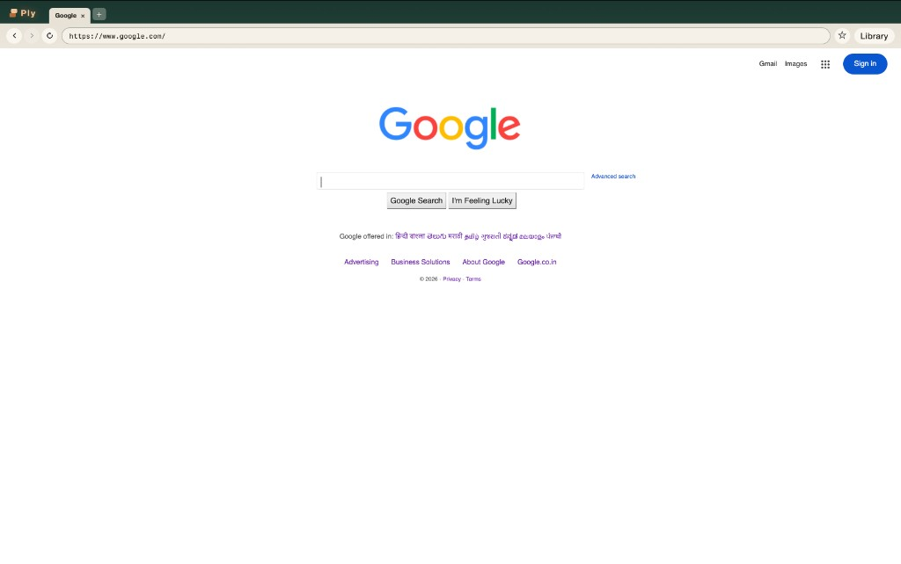

<!-- ai-generated -->
# Ply

A personal desktop web browser. **Ply** means a layer — chrome (tabs, address bar) is one ply, the page engine is the other.

Owner: [akhilf](https://github.com/akhilf)



## What it does (Stage 1)

- Tabs, address bar, back / forward / reload
- Bookmarks and history (SQLite in the app data directory)
- Isolated chrome: untrusted pages never share JavaScript with the toolbar
- Search: non-URL input goes to DuckDuckGo
- macOS, Windows, and Linux (Tauri 2 + OS webview)

Stage 2 (not in this tree yet) will add a small HTML/CSS engine in Rust. Same chrome, different page ply.

## Clone and run (new developers)

### 1. Prerequisites

Install these **before** `npm install`:

| Tool | Version | Notes |
| --- | --- | --- |
| [Git](https://git-scm.com/) | any recent | clone the repo |
| [Node.js](https://nodejs.org/) | **20.x** | 20.6+ works. Do not use Node 18. Vite 5 is pinned on purpose. |
| [Rust](https://rustup.rs/) | stable (`rustup`) | needed for the Tauri core |

**macOS:** Xcode Command Line Tools (desktop only; full Xcode is not required):

```bash
xcode-select --install
```

**Windows:** [Visual Studio C++ build tools](https://visualstudio.microsoft.com/visual-cpp-build-tools/) and [WebView2](https://developer.microsoft.com/en-us/microsoft-edge/webview2/) (already present on most Windows 10/11 machines).

**Linux (Debian/Ubuntu):**

```bash
sudo apt update
sudo apt install libwebkit2gtk-4.1-dev build-essential curl wget file libxdo-dev libssl-dev libayatana-appindicator3-dev librsvg2-dev
```

System package lists for other distros: [Tauri 2 prerequisites](https://v2.tauri.app/start/prerequisites/).

### 2. Clone

```bash
git clone https://github.com/akhilf/ply.git
cd ply
```

### 3. Install JS dependencies

```bash
npm install
```

The Tauri CLI comes from this `npm install`. You do not install `@tauri-apps/cli` globally.

### 4. Run the desktop app

```bash
npm run tauri dev
```

The first Rust compile can take several minutes. After that, a **Ply** window opens. Vite serves chrome at `http://localhost:1420/` (that URL is the toolbar, not a substitute for the desktop window).

Type a URL (for example `www.google.com`) and press Enter.

### 5. Tests (optional)

```bash
npm test
cd src-tauri && cargo test --lib
```

## Layout

| Path | Role |
| --- | --- |
| `src/` | TypeScript chrome UI |
| `src-tauri/` | Rust session, tabs, store, native webviews |
| `index.html` | Chrome shell only — pages load in separate webviews |
| `docs/ply.png` | Screenshot of Ply on GitHub |

## Name

Ply is a working product name, not an acronym. Rename is a label change only.
<!-- ai-generated end -->
